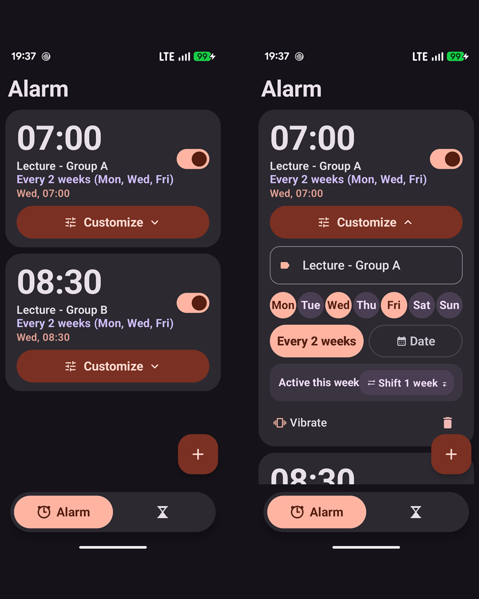

# Clock

A light, Material 3 Expressive alarm clock and timer for Android.

The one thing that pushed me to build it: **an alarm that repeats every 2 weeks** (lectures on alternate weeks). Most clock apps can only repeat weekly or daily, so I made one that can.

[-6750A4?style=for-the-badge&logo=android&logoColor=white)](https://github.com/Mikhas-Rahulia/pixel-clock/releases/download/v1.0.0-beta.3/pixel-clock-1.0.0-beta.3-arm64-v8a.apk)
[](https://github.com/Mikhas-Rahulia/pixel-clock/releases)



More: [alarm list](docs/screenshots/01-every-2-weeks-list.png), [biweekly editor](docs/screenshots/02-biweekly-editor.png), [pause between dates](docs/screenshots/03-pause-between-dates.png), [pause editor](docs/screenshots/04-pause-editor.png).

## Features

- **Alarms**
  - Defaults to the nearest full hour: today if still ahead, otherwise tomorrow.
  - One-time by default. Pick a date, or add weekdays with one tap afterwards.
  - Repeat **every 2 weeks** on chosen days.
  - **Pause** an alarm for one day or a range of dates (holidays, exams). It resumes by itself afterwards.
  - Alarms survive app updates. Every change is also saved to a local JSON backup. After a reinstall, drop `alarms-import.json` in the app's files folder to merge them back.
  - Alarms survive app updates. Every change is also saved to a local JSON backup. After a reinstall, drop `alarms-import.json` in the app's files folder to merge them back.
- **Timers**
  - Real system alarms (`AlarmManager`), so the timer runs in the background and fires on time.
  - Full-screen "Time's up" screen with Snooze and Stop, and +5 min from the notification.
  - Repeated runs of the same timer within an hour show total minutes and run count, e.g. `12 min · 3×`.
- **Design**
  - Material 3 Expressive, fixed palette, predictive back gesture, animated tab icons.

## Download

Pre-release builds are on the [Releases](https://github.com/Mikhas-Rahulia/pixel-clock/releases) page. There is one file: `pixel-clock-1.0.0-beta.3-arm64-v8a.apk`, for 64-bit ARM phones, which is almost every phone made after 2016.

Checksum is in `SHA256SUMS.txt` next to the file. Android 8.0 (API 26) or newer. You may need to allow installing apps from your browser or file manager the first time. These pre-release builds are signed with a debug key, so they will not update over a future release signed with a different key.

## Privacy

No internet permission, no analytics, no ads, no data collection. Everything stays on the device. See [PRIVACY_POLICY.md](PRIVACY_POLICY.md) (PL/EN).

## Build

Requirements: Android Studio or the Android SDK, JDK 17+, Android 8.0 (API 26) or newer on the device.

```bash
./gradlew :app:assembleRelease
```

The release build is minified with R8. It is currently signed with the Android debug key, so for distribution you need your own signing configuration.

Unit tests:

```bash
./gradlew :app:testDebugUnitTest
```

## Legal

- License: [MIT](LICENSE)
- Terms of use (PL/EN): [REGULAMIN.md](REGULAMIN.md)
- Privacy policy (PL/EN): [PRIVACY_POLICY.md](PRIVACY_POLICY.md)

## Third-party

Built with Jetpack Compose and Material 3 (Apache License 2.0), Kotlin Coroutines and kotlinx.serialization (Apache License 2.0).

## Contact

Questions and bug reports: [GitHub Issues](https://github.com/Mikhas-Rahulia/pixel-clock/issues).
