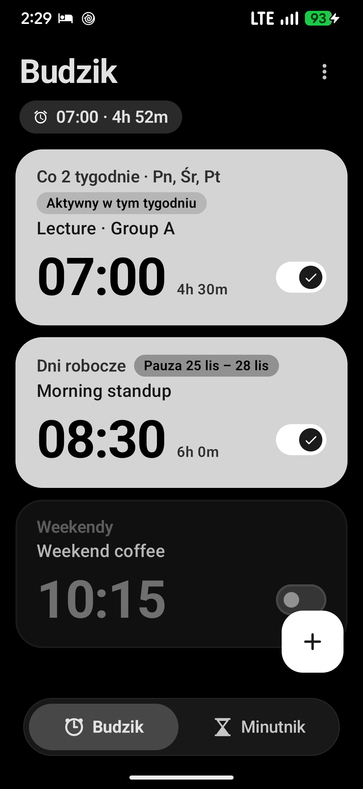
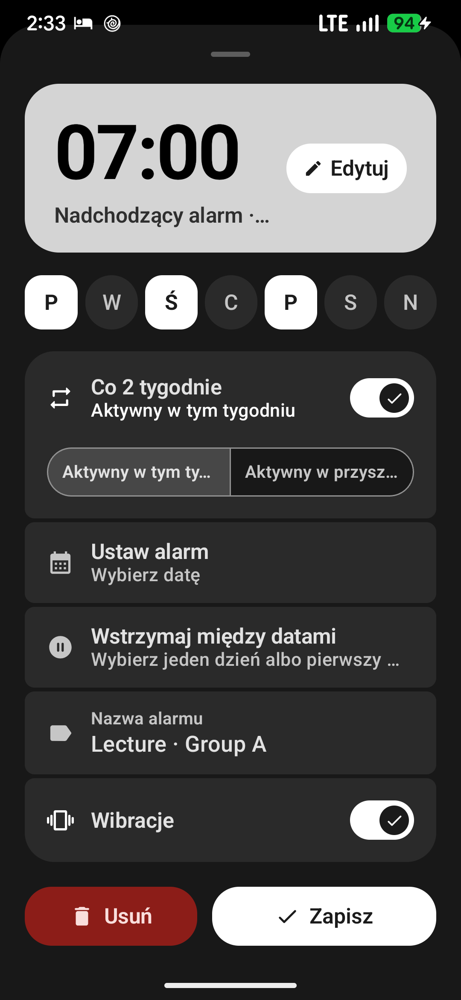
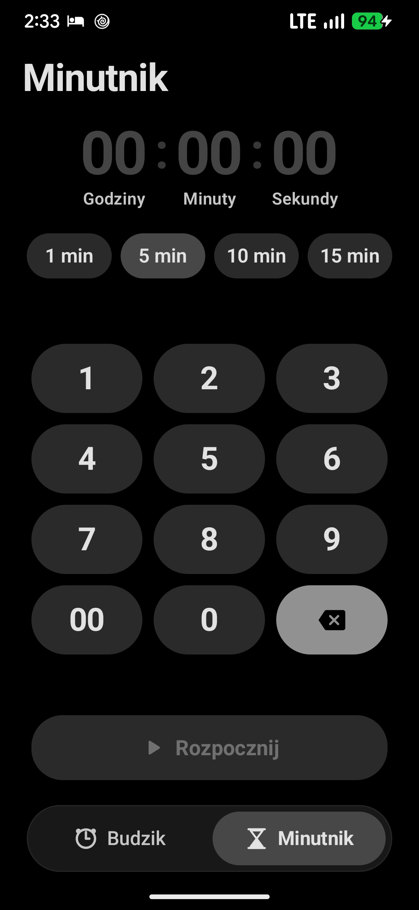

# Clock

A light, Material 3 Expressive alarm clock and timer for Android.

The one thing that pushed me to build it: **an alarm that repeats every 2 weeks** (lectures on alternate weeks). Most clock apps can only repeat weekly or daily, so I made one that can.

[-6750A4?style=for-the-badge&logo=android&logoColor=white)](https://github.com/Mikhas-Rahulia/pixel-clock/releases/download/v1.0.0-beta.15/pixel-clock-1.0.0-beta.15-arm64-v8a.apk)
[](https://github.com/Mikhas-Rahulia/pixel-clock/releases)

<p>
  
  
  
  
</p>

Screenshots: [alarm list](docs/screenshots/01-every-2-weeks-list.png), [biweekly editor](docs/screenshots/02-biweekly-editor.png), [timer keypad](docs/screenshots/03-timer-keypad.png), [running timer](docs/screenshots/04-timer-running.png).

## Important: Always Preserve Alarms After Updates

**User alarms MUST always survive app updates, schema changes, and OS reboots.** This is enforced in code and must be respected in every future change:

### Built-in Automatic Preservation
- **Multi-layer atomic storage (local only)**: Every change is atomically written to Device-Encrypted (DE) internal storage (`alarms-store.json`, `alarms-backup.json`, and a rolling non-empty `alarms-prev.json` snapshot), mirrored to DE `SharedPreferences`, and backed up to internal Credential-Encrypted (CE) storage once unlocked.
- **Exhaustive upgrade migration**: On startup, unlock (`USER_UNLOCKED`), and app update (`MY_PACKAGE_REPLACED`), `AlarmRepository.ensureLoadedAndMigrated()` recovers alarms from all historical storage paths (DE store, DE backup, rolling snapshot, DE/CE `SharedPreferences`, CE internal backup, legacy external backup, and legacy package) and automatically reschedules every enabled alarm via `AlarmManager`.
- **Direct Boot anti-wipe guard**: If the app starts before the user unlocks the phone (e.g., after an overnight OTA reboot), it never overwrites unmigrated CE alarms with an empty store.
- **Resilient backward-compatible JSON schema**: `AlarmBackup` uses `encodeDefaults = true`, `ignoreUnknownKeys = true`, `coerceInputValues = true`, and per-element JSON decoding so schema additions or a single corrupt entry can never wipe the user's alarm list.
- **Guaranteed flush on stop/update**: `MainActivity.onStop()`, `SetAlarmActivity`, and `AlarmReceiver` flush pending alarm writes synchronously so an update or process kill immediately after an edit cannot lose data.
- **Manual JSON Export / Import**: Use the `⋮` menu on the Alarm tab to export or import `alarms-backup.json` via Android's document picker (zero extra permissions, stays 100% local), or drop `alarms-import.json` into the app's external files folder.

### Rules for Future Updates & Contributors
1. **Never change `applicationId`** (`io.github.mikhasrahulia.pixelclock`) or the release signing key — Android only preserves app data on in-place updates when both match.
2. **Always increment `versionCode`** for every new APK build.
3. **Keep `AlarmModel` strictly backward-compatible**: only add fields with safe default values, never rename or remove serialized property names without a migration, and keep `AlarmBackupTest` passing for legacy v1/v2/v3 payloads.
4. **Never remove legacy storage fallback readers** in `AlarmBackup` or bypass `BootReceiver` (`MY_PACKAGE_REPLACED`, `BOOT_COMPLETED`, `LOCKED_BOOT_COMPLETED`, `USER_UNLOCKED`).

## Features

- **Alarms**
  - Defaults to the nearest full hour: today if still ahead, otherwise tomorrow.
  - Live next-alarm countdown banner in the header and relative countdown on every active card.
  - One-time by default. Tap any alarm to open the Material 3 Expressive bottom-sheet editor with shape-morphing weekday pills, specific date picker, and grouped settings.
  - Repeat **every 2 weeks** on chosen days, with a 1-tap `Active this week` / `Active next week` segmented switcher.
  - **Pause** an alarm for one day or a range of dates (holidays, exams). It resumes by itself afterwards.
  - Bulletproof update preservation + one-tap JSON Export/Import from the header menu.
- **Timers**
  - Real system alarms (`AlarmManager`), so the timer runs in the background and fires on time.
  - Material 3 Expressive keypad with tabular `HH:MM:SS` readout, quick preset pills (`1`, `5`, `10`, `15 min`), and tactile pill keys.
  - Animated wavy circular countdown ring that flattens smoothly when paused, shape-morphing Play/Pause control, `+1:00` / `+5:00` quick buttons, and Reset.
  - Full-screen "Time's up" screen with animated scalloped badge, Snooze (+5 min), and Stop.
  - Repeated runs of the same timer within an hour show total minutes and run count, e.g. `12 min · 3×`.
- **Design**
  - Full **Material 3 Expressive** (`MaterialExpressiveTheme` + `MotionScheme.expressive()`), Material You Dynamic Color harmonized over pure `#000000` AMOLED dark mode, tabular numerals, Pixel LRA haptics, native predictive back gestures, and floating pill navigation dock with animated tab icons.

## Download

Pre-release builds are on the [Releases](https://github.com/Mikhas-Rahulia/pixel-clock/releases) page. There is one file per release (`pixel-clock-*-arm64-v8a.apk`) for 64-bit ARM phones.

Checksum is in `SHA256SUMS.txt` next to the file. You may need to allow installing apps from your browser or file manager the first time. These pre-release builds are signed with a debug key, so they will not update over a future release signed with a different key.

## Privacy

No internet permission, no analytics, no ads, no data collection. Everything stays on the device. See [PRIVACY_POLICY.md](PRIVACY_POLICY.md) (PL/EN).

## Build

Requirements: Android Studio or the Android SDK, JDK 17+, Android 14 (API 34) or newer on the device.

```bash
./gradlew :app:assembleRelease
```

The release build is minified with R8. It is currently signed with the Android debug key, so for distribution you need your own signing configuration.

Unit tests:

```bash
./gradlew :app:testDebugUnitTest
```

## Legal

- License: [MIT](LICENSE)
- Terms of use (PL/EN): [REGULAMIN.md](REGULAMIN.md)
- Privacy policy (PL/EN): [PRIVACY_POLICY.md](PRIVACY_POLICY.md)

## Third-party

Built with Jetpack Compose and Material 3 (Apache License 2.0), Kotlin Coroutines and kotlinx.serialization (Apache License 2.0).

## Contact

Questions and bug reports: [GitHub Issues](https://github.com/Mikhas-Rahulia/pixel-clock/issues).
