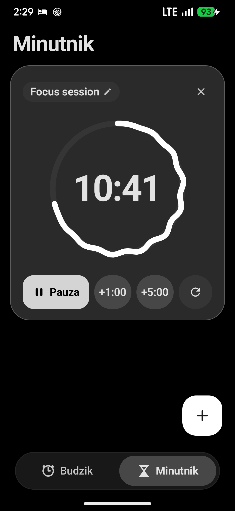

# Clock

An Android alarm clock built for one surprisingly rare need: **alarms that repeat every 2 weeks**.

Most alarm apps only let you repeat daily or weekly. If your schedule alternates — odd/even week university lectures, rotating shifts, or every-other-week routines — you normally end up toggling alarms on and off by hand every Sunday. Here, you set it once, pick **This week** or **Next week**, and forget about it. You can also **pause** any alarm for a day or date range (holidays, exams) and let it resume automatically.

  
  
  
  

## Why it's useful

- **Every 2 weeks alarms** — repeat on chosen weekdays every alternate week, with a one-tap switch between *Active this week* and *Active next week*.
- **Pause between dates** — skip an alarm for a single day or a holiday range without turning it off; it resumes on its own afterwards.
- **Alarms survive updates** — preserved automatically across app updates and reboots, with local JSON export/import built into the menu.
- **Clean timers** — quick presets, wavy countdown ring, `+1:00` / `+5:00` adjustments, and reliable background alerts.
- **Private & offline** — no internet permission, no ads, no analytics. Everything stays on your phone.

## Legal & Contact

- License: [MIT](LICENSE) · Privacy: [PRIVACY_POLICY.md](PRIVACY_POLICY.md) · Terms: [REGULAMIN.md](REGULAMIN.md)
- Issues & feedback: [GitHub Issues](https://github.com/Mikhas-Rahulia/pixel-clock/issues)
